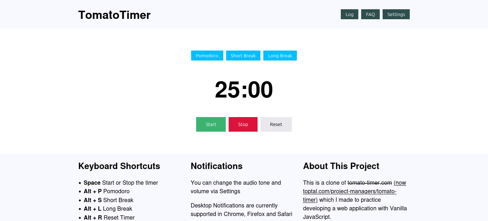

# TomatoTimer

This is a clone of TomatoTimer which I made to practice developing a web application with Vanilla JavaScript.

**[Live demo](https://tomjbradley.github.io/tomato-timer/)**

## Features
- Pomodoro timer for studying or working
- Adjustable work and break periods
- Control the timer with hotkeys
- Saves a log of completed pomodoros
- Configurable sound and push notification at the end of study blocks/breaks

## Tech stack
HTML, CSS, JavaScript, Notifications API, Web Storage API.

## Running locally
Simply open the index.html file in a modern web browser.

## What I learned
Persisting data in `localStorage`, using the Notifications API and web audio, and listening to user input for hotkeys.
